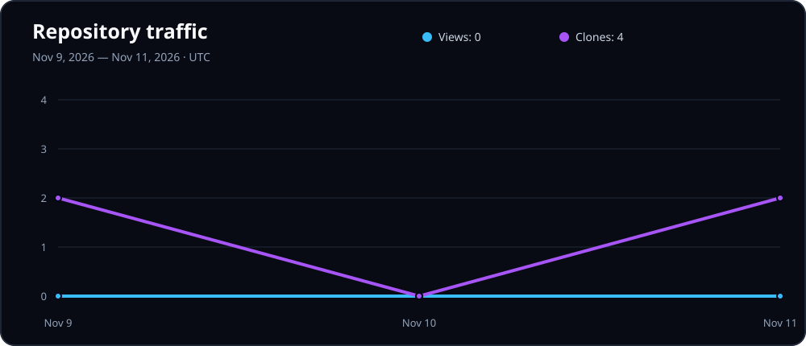

# Learn Crypto

Learn Crypto is an interactive cryptography learning site built around small
experiments, proofs, attack simulations, and review questions. Everything runs
in the browser so learners can change inputs and immediately see how the
underlying probability or cryptographic operation changes.

Visit the live site at [learncrypto.z3rø.com](https://learncrypto.z3rø.com).

> **Educational use only:** The examples intentionally simplify or break
> cryptographic schemes to teach their security properties. They are not
> production encryption implementations.

## Lessons and labs

| Topic | What learners can do | Route |
| --- | --- | --- |
| Probability Basics | Explore events and conditional sample spaces with two dice | `/probability-basics` |
| Bayes Theorem | Connect conditional probability to cryptographic secrecy | `/bayes-theorem` |
| Perfect Secrecy | Compare attacker beliefs under uniform and insecure keys | `/perfect-secrecy` |
| One-Time Pad | Encrypt, decrypt, and demonstrate why pad reuse fails | `/one-time-pad` |
| Attack Simulator | Break identity encryption and solve a reused-pad crib-dragging mission | `/attack-simulator` |
| CPA Security | Query an encryption oracle and distinguish a challenge ciphertext | `/cpa-security` |
| CBC and CTR Modes | Visualize block-mode data flow and counter-generated pads | `/modes` |
| Message Authentication Codes | Tamper with CTR-style ciphertext and verify HMAC tags | `/macs` |
| Hash Functions | Compare SHA-256 outputs and find an 8-bit-prefix collision | `/hash-functions` |
| Practice Mode | Take mixed or topic-filtered quizzes with lesson review links | `/practice` |
| Resources | Browse and search curated external learning materials | `/resources` |

## Technology

- React 19
- React Router 7
- Vite 8
- Browser Web Crypto for random pads, SHA-256, and HMAC-SHA-256
- Plain CSS with responsive and keyboard-accessible controls

The app has no backend, accounts, cookies, analytics, or learner tracking. Quiz
and lab state stays in the current browser session.

## Repository traffic dashboard

GitHub exposes only a rolling 14-day window of repository views and full clones.
The `Collect repository traffic` workflow runs daily, retains that data, and
regenerates the graph below so the README can show history from the first
collection onward. Tracking begins on November 9, 2026.



To enable collection:

1. Create a fine-grained GitHub personal access token limited to this repository
   with **Administration: Read-only** permission.
2. Add it as a repository Actions secret named `TRAFFIC_TOKEN`.
3. Open **Actions → Collect repository traffic → Run workflow** once.

The secret is used only by GitHub Actions and is never exposed in the README or
website. The workflow uses the repository `GITHUB_TOKEN` with `contents: write`
only to commit the updated JSON history and SVG graph.

## Run locally

Requirements:

- Node.js 22 or a compatible current release
- npm

From the repository root:

```bash
cd cipherquest
npm ci
npm run dev
```

Open the local URL printed by Vite, normally
[http://localhost:5173](http://localhost:5173).

## Available commands

Run these commands inside `cipherquest/`:

| Command | Purpose |
| --- | --- |
| `npm run dev` | Start the local development server |
| `npm run build` | Create the production build in `dist/` |
| `npm run preview` | Preview the production build locally |
| `npm run lint` | Check the JavaScript and JSX source |
| `npm audit` | Check installed dependencies for known advisories |

## Project structure

```text
Learn-Cryptography/
├── .github/             # scheduled repository traffic collector
├── README.md
└── cipherquest/
    ├── public/           # favicon and deployment security headers
    ├── src/
    │   ├── components/   # shared navigation
    │   ├── data/         # practice question bank
    │   ├── pages/        # lessons, labs, and quiz pages
    │   ├── utils/        # reusable crypto and probability helpers
    │   ├── App.jsx       # routes and site layout
    │   └── index.css     # shared and responsive styles
    ├── index.html
    ├── package.json
    └── vite.config.js
```

## Security and deployment

The production build is a static single-page application. Deploy the contents
of `cipherquest/dist/` and configure unknown application routes to serve
`index.html`.

[`public/_headers`](cipherquest/public/_headers) defines the Content Security
Policy, anti-framing, MIME-sniffing, referrer, and browser permissions headers.
Confirm that the hosting platform applies this file after deployment.

Use `npm ci` for reproducible installs. The package lock pins audited versions,
and the `minimatch` override selects a patched dependency for ESLint 10. After a
dependency update, run:

```bash
npm audit
npm run lint
npm run build
```

## Project note

Learn Crypto was made with AI and vibe-coded. The educational explanations,
calculations, interactive states, accessibility behavior, and security settings
are still reviewed and tested as part of development.
